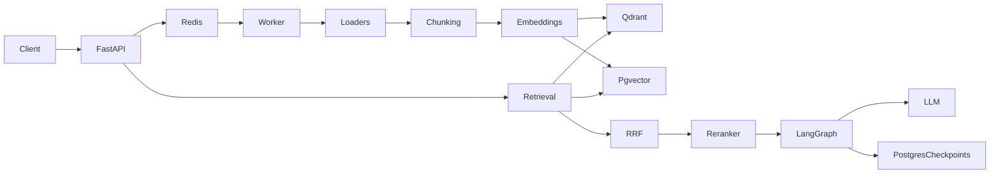

# Architecture

## Runtime boundaries

Clients call the versioned FastAPI boundary. Query traffic is delegated synchronously to an
injected `RAGService`; ingestion commands enter an injected `JobQueue` and are processed outside
the request lifecycle. This keeps HTTP concerns separate from domain indexing and generation.

The default `InMemoryRAGService` provides deterministic lexical retrieval for smoke tests.
`InMemoryJobQueue` provides process-local idempotency, retries, cancellation, and dead-letter
states. Neither is durable. Production deployments should inject durable service adapters and
`RedisJobQueue`.

## Request flow

1. Ingestion validates input and derives or accepts an idempotency key.
2. The queue returns the existing job for duplicate keys, otherwise creates a pending job.
3. A worker claims the job, invokes the handler, and completes, retries, or dead-letters it.
4. Query routes call the service and return an answer plus document-level citations.
5. Streaming emits `token`, `citations`, then `done` SSE events.

Health endpoints separate process liveness from dependency readiness. Administrative diagnostics
are token protected and disabled when no token is configured.

## Extension points

- Implement `RAGService` around the domain retrieval/generation pipeline.
- Implement `JobQueue` for another broker while preserving state transitions.
- The bundled worker validates, loads, and chunks local sources. Inject a
  persistent registry and `IndexingService` for deployment-specific storage.
- Export application telemetry from the protected metrics hook or replace it with an
  OpenTelemetry/Prometheus adapter.

See [ADR-0001](adr/0001-api-worker-boundaries.md) for the boundary decision.
Vector-store and retrieval decisions are recorded in
[ADR-0002](adr/0002-vector-store-adapters.md) and
[ADR-0003](adr/0003-hybrid-retrieval.md).
